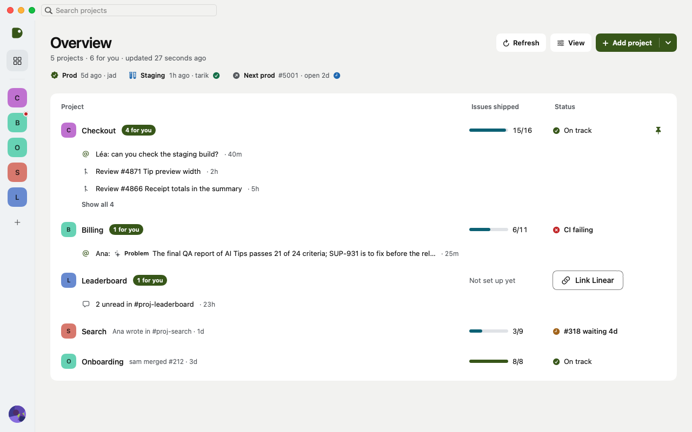

<p align="center">
  <picture>
    <source media="(prefers-color-scheme: dark)" srcset="docs/brand/dever-mark-lime.svg">
    
  </picture>
</p>

<h1 align="center">Dever</h1>

<p align="center">
  <b>One window for everything your project is waiting on you for.</b><br>
  Slack, Linear and GitHub, side by side, per project. A native Mac app.
</p>

<p align="center">
  
  
  
  
  
</p>

<p align="center">
  <picture>
    <source media="(prefers-color-scheme: dark)" srcset="docs/screenshots/overview-dark.png">
    
  </picture>
</p>

## Why

A project lives in three places: the conversation in Slack, the plan in Linear, the code on GitHub.
Dever puts the three in one place and answers the questions you open them for:

- 👀 **What is waiting for me?** Mentions, unread messages and reviews asked of you, under each project.
- 🧭 **Where do I start?** A "Start here" pick among your issues, with its action one click away.
- 🚦 **Is it broken?** Checks, reviews and previews with their age. Never an old state shown as current.
- 💬 **Without leaving.** Read and answer threads, move an issue, deploy a preview, all from the app.
- ✨ **A little help.** Long messages summarised and failed pipelines explained, by the Mac's own model. Nothing leaves your machine.

## Get started

You need a Mac on macOS 14 or later, and Xcode's command line tools.

```bash
git clone https://github.com/eri/dever.git && cd dever
```

```bash
cp config/dever.example.json config/dever.json
```

```bash
./scripts/build-app.sh && open build/Dever.app
```

Fill in `config/dever.json` before building: it points Dever at your team's OAuth apps.
An admin sets those up once, in about ten minutes: [docs/SETUP.md](docs/SETUP.md).

Then Dever walks you through the rest: connect your accounts, say where your code lives, add a first project.

## Your accounts stay yours

Dever signs in with each service's official flow, in your browser. No API key to paste, and no server in between.

| | How you connect | Where it is kept |
|---|---|---|
| **Slack** | "Connect" opens your browser | macOS Keychain |
| **Linear** | "Connect" opens your browser | macOS Keychain |
| **GitHub** | A one-time code, or your existing `gh` login | macOS Keychain |

Your projects are a plain file on your Mac. The AI features run on the Mac's built-in model and can be switched off in Settings.

## Go deeper

| | |
|---|---|
| 🛠 [Development notes](docs/DEVELOPMENT.md) | Projects, repository modes, previews, screenshots for development |
| ⚡️ [Data freshness](docs/data-freshness.md) | How Dever stays up to date without reloading everything |
| ✨ [On-device intelligence](docs/on-device-ai.md) | What the Mac's model does, and what it never does |
| 🎨 [Brand](docs/brand/README.md) | The mark and its colours |
| 🤝 [Contributing](CLAUDE.md) | The rules every change follows. Run `swift test` before a push |

## Licence

Dever is open source under the [MIT licence](LICENSE).
